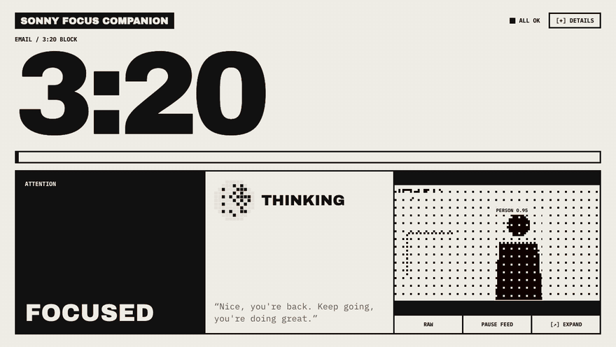
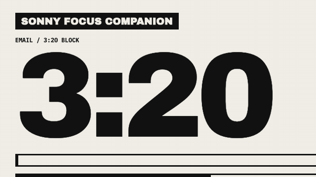
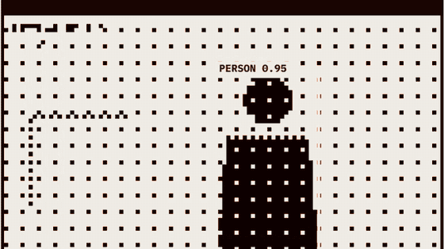
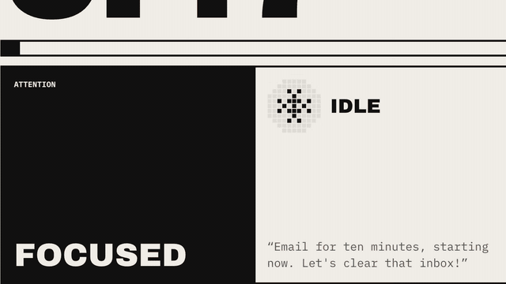
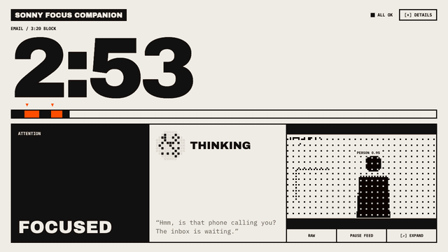

<p align="center">
  <picture>
    <source media="(prefers-color-scheme: dark)" srcset="docs/media/banner-dark.svg">
    
  </picture>
</p>

<p align="center">
  
  <a href="https://huggingface.co/reachy-mini"></a>
  
  <a href="https://github.com/iamtokarev/sonny-focus-companion/actions/workflows/ci.yml"></a>
</p>

<p align="center"><b>Sonny Focus Companion for the <a href="https://huggingface.co/reachy-mini">Reachy Mini</a> robot.</b><br>Tell it what you're working on and for how long. It watches the desk through its camera,<br>and when the phone starts winning, it says something.</p>

<p align="center"></p>

## What Sonny does

<table>
  <tr>
    <td width="50%"><br><b>Starts on your word.</b> "Hey Sonny, email for ten minutes." The clock starts. No app to tap.</td>
    <td width="50%"><br><b>Sees phone use and an empty chair.</b> On your Mac, about 18 ms a frame. Video never leaves it.</td>
  </tr>
  <tr>
    <td><br><b>Nudges, then escalates.</b> Subtle first, firmer if it keeps going, with 18 emotion moves.</td>
    <td><br><b>Stops when you say so.</b> Time left, check-ins, pause, extend, end. Each session ends with its tally and a log.</td>
  </tr>
</table>

<sub>Every clip is the real Dashboard replaying the session log drawn below (<code>mise run dev:backend --log …</code>); with no robot attached, the camera shows its drawn stand-in for you and your phone.</sub>

## A session, at a glance

<picture>
  <source media="(prefers-color-scheme: dark)" srcset="docs/media/session-dark.svg">
  
</picture>

Drawn from a real session log: three phone pickups, Sonny's first two Nudges word for word, and a third that got firmer before the session was ended.

<details>
<summary><b>Set up and run</b>: <code>mise run bootstrap</code>, <code>mise run app</code>, then say "Hey Sonny"</summary>

<br>

Install [mise](https://mise.jdx.dev/installing-mise.html) if needed, then bootstrap the checkout:

```bash
curl -fsSL https://mise.run | sh
export PATH="$HOME/.local/bin:$PATH"
mise run bootstrap
```

Keep `~/.local/bin` on your shell's `PATH` for future terminals.

`bootstrap` installs the tools pinned in `mise.toml`, syncs locked Python and Dashboard dependencies,
builds the Dashboard and installs pre-commit hooks. uv manages Python 3.12 and `.venv`.
No shell activation is needed for these commands.

Sonny's daemon and this app's `reachy-mini` SDK must be the same version (1.14.0).

```bash
mise run app
```

`mise run start` is an alias for the same command.

### Upgrading from Sonny Phone Tracker

Run `mise run bootstrap` from the updated checkout and reload any open Dashboard tabs. If you use
the Python package or commands directly, switch to `sonny_focus_companion` for imports and
`sonny-focus-companion` or `sonny-focus-companion-dashboard-dev` for commands. Change any
app-specific `SONNY_*` variables you set to the `SONNY_FOCUS_COMPANION_*` prefix, including
`CONFIG`, `VERBOSE`, `LIVE`, `LIVE_RUNS` and `CLIP_DETECTIONS`. Existing TOML overrides, session
logs and saved Dashboard preferences still work. Dashboard RPC clients should use
`sonny-focus-companion.snapshot` and `sonny-focus-companion.event`.

The LLM runs on OpenRouter: put `OPENROUTER_API_KEY=...` in a `.env` at the repo root (it is
git-ignored). The first start downloads the voice models from Hugging Face, and exports RF-DETR
Nano to CoreML in `models/` (about 20 s, before `ready`; it prints `vision: RF-DETR Nano on
CoreML on GPU` once loaded).

Start it from a terminal with macOS Local Network permission: uv's Pythons are blocked when
started from elsewhere (`[Errno 65] No route to host`). It prints `ready` once Sonny's speaker
link is up and the voice loop is listening. Say "Hey Sonny" to chat, or to start a Focus
Session ("Hey Sonny, let's work on my slides for 25 minutes"); in a session you can ask for the
time left, extend, pause, resume, end, take an Excuse or ask for a Check-in. Ctrl-C puts Sonny in
its sleep pose. Each session's log is a JSON Lines file in `logs/`.

The terminal shows one line per thing Sonny heard, said or did, plus warnings and errors.
Pipecat's and the robot SDK's debug lines stay out of it: they go to `logs/sonny-focus-companion.log`, which is
emptied on each start, so only the last run is kept. Run `uv run sonny-focus-companion --verbose` (or set
`SONNY_FOCUS_COMPANION_VERBOSE=1`) to see them in the terminal as well.

The Dashboard is a page Sonny serves on this Mac while it runs. The run task builds it into
the git-ignored `src/sonny_focus_companion/static/`; after `ready` Sonny prints `Dashboard: http://127.0.0.1:8042`.
Set `open_browser = true` under `[dashboard]` in `src/sonny_focus_companion/sonny-focus-companion.toml` to have it open a tab.

Every tunable number lives in [src/sonny_focus_companion/sonny-focus-companion.toml](src/sonny_focus_companion/sonny-focus-companion.toml). To override, copy
the whole file and point `SONNY_FOCUS_COMPANION_CONFIG` at the copy.

</details>

<details>
<summary><b>How Sonny moves</b>: still when idle, level in a session, never lost for long</summary>

<br>

Sonny's head: still at neutral in idle; facing you (daemon face tracking) while you talk to it;
level and still in a Focus Session, with tracking stopped before the session starts. In a session
Sonny watches through its camera (not in a Pause) and keeps its body facing you with the head
centred: one slow turn of both re-centres you when you've stayed off-centre for 3 s. After 10 s
with nobody in frame it searches once, with the head first and then turning the body, and turns
to face you once found. Phone Use and Away show in the terminal and go to the session log,
with a detection summary every second. The agent colours its lines with `play_emotion` (18 moves,
played on the daemon with their sound at volume 62); a move and a line never overlap and play in
the order the agent called them.

</details>

<details>
<summary><b>Dashboard without the robot</b>: <code>mise run dev</code></summary>

<br>

`sonny-focus-companion-dashboard-dev` serves the Dashboard's routes on Sonny's port (8042) with no robot, voice or
LLM: it replays session logs as the state feed and fills the camera feed. Start it together with
Vite at http://127.0.0.1:5173/static/ (which proxies `/rpc` and `/ws` to it):

```bash
mise run dev         # placeholder scene; Ctrl-C stops both servers
```

To replay logs or use the webcam, run `mise run dev:web` in one terminal and the backend
with arguments in another:

```bash
mise run dev:backend --log logs/session-*.jsonl --speed 10
mise run dev:backend --log logs/session-20261103-*.jsonl --webcam
```

Without `--webcam` (or `--clip video.mp4`) the camera shows a drawn placeholder scene whose boxes
follow the replayed Attention State. `--speed N` plays N times faster and shortens the session's
Duration to match, so the page's timer runs out with the replay.

</details>

<details>
<summary><b>Develop</b>: <code>mise run check</code></summary>

<br>

```bash
mise run check       # pre-commit, Python tests, frontend checks and build
mise run test -q     # Python tests only; accepts pytest arguments
mise run build       # Dashboard typecheck and build
```

List tasks with `mise tasks ls`. For other commands, use `mise exec -- <command>`
(for example, `mise exec -- bun --cwd web run gen:protocol`).

The agent scenarios (`tests/test_agent_scenarios.py`) replay owner lines and session time through
the real tools and conductor with a scripted agent. To run them against the configured model
instead (costs OpenRouter credit), after any change to the prompt or model:

```bash
SONNY_FOCUS_COMPANION_LIVE=1 mise run test -m live -s tests/test_agent_scenarios.py
```

Ruff lints and formats through pre-commit; CI runs the same hooks plus the tests on macOS.

</details>
